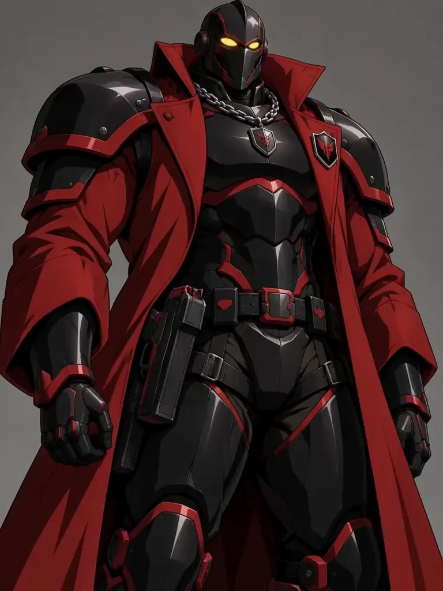

# Jury: idle loop

Jury, one of my Voyage characters, as a seamless idle loop: a slow breath through the chest and
shoulder plates, his weight shifting onto one leg and back (hips, belt and knee moving), and the
long red coat flowing behind his legs while his fists stay in front of it. Made locally with
LTX-2.5 as two halves, portrait -> weight-shift still -> portrait, then the tail blended into the
first frame so the wrap doesn't pop.

Files:
- `jury-loop-4s.webp`: the loop, 768x1024, 24 fps, loops forever, 4.0 MB
- `jury-loop-4s.mp4`: the same loop at 48 fps
- `jury-raw-4s-with-audio.mp4`: the untouched render with its wind and breath sound (not looped)
- `jury-source.png`: the portrait it starts and ends on (768x1024)
- `stills/jury-weight-shift.png`: the middle still (weight on one leg) that drives the hips
