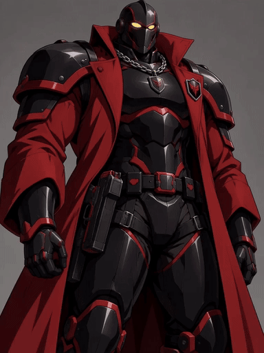

# Jury: idle loop

Jury, one of my Voyage characters, as a seamless idle loop: the long red coat flowing in the
wind and a slow breath through the chest and shoulder plates. Made locally with LTX-2.5
(first and last frame both set to the portrait, so the clip ends where it starts), then the
tail blended into the first frame so the wrap doesn't pop.

Files:
- `jury-loop-4s.mp4` / `.gif`: 4 s loop, 48 fps (gif at 24 fps), more coat movement
- `jury-loop-2.7s.mp4` / `.gif`: 2.7 s loop, calmer
- `jury-raw-4s-with-audio.mp4`: the untouched render with its wind and breath sound (not looped)
- `jury-source.png`: the portrait it was made from (768x1024)
